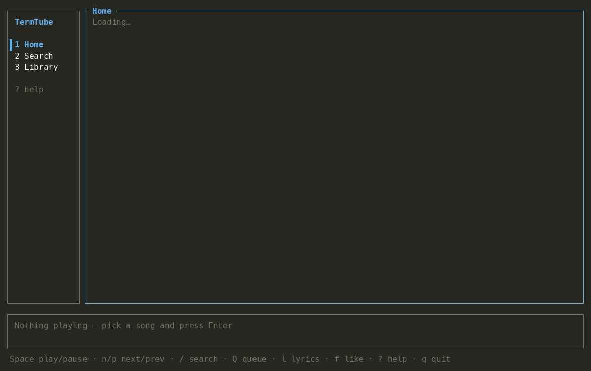

# TermTube — lightweight YouTube Music client for the terminal

**A fast, low-memory YouTube Music player for Linux and macOS.** Browse your Home feed, search songs, albums and artists, play your playlists and *Liked music*, keep the music going with radio, like songs and read lyrics — all from the terminal, using **~50 MB of RAM** instead of the ~500 MB of the YouTube Music desktop app or a browser tab.



**[⬇ Download](https://github.com/javierlongoriaroche/termtube/releases/latest)** · Linux AppImage (x86_64 / ARM64, no install needed) · macOS (Apple Silicon & Intel)

## Why TermTube?

| | YouTube Music desktop / browser | TermTube |
|---|---|---|
| RAM while playing | 460–600 MB | **~50 MB** |
| CPU while playing | ~3–4 % | ~5 % (mostly audio decoding) |
| Your library, likes and recommendations | ✓ | ✓ (same account) |
| Works over SSH / in a tmux pane | ✗ | ✓ |
| Keyboard-only | ✗ | ✓ |

Ideal for machines with 8 GB of RAM or less, developers who live in the terminal, and anyone looking for a **YouTube Music lite** experience.

## Features

- Home feed (Quick picks, mixes, listen again…) with pagination
- Search by songs, albums, artists or playlists
- Library: your playlists and *Liked music*, with a ♥ on liked songs everywhere
- Album, playlist and artist pages
- Radio: playing a single song keeps the queue going with similar music
- Queue panel: reorder, remove, play next, shuffle, repeat
- Like/unlike synced with your account (`f`), plays recorded in your history
- Lyrics panel (`l`)
- Stereo level meter in the player bar (toggle with `v` or in the config)
- Guided sign-in: finds your session in any installed browser or opens music.youtube.com for you

## How it works

- **Data**: YouTube Music's internal API (InnerTube) through [`ytmapi-rs`](https://docs.rs/ytmapi-rs), authenticated with your browser session.
- **Audio**: [mpv](https://mpv.io) controlled over JSON IPC (seeking, gapless, media keys, macOS Now Playing).
- **Streams**: [yt-dlp](https://github.com/yt-dlp/yt-dlp) resolves the next song in the background so it starts instantly.

## Requirements

```bash
brew install mpv yt-dlp      # macOS (Linux: use your package manager)
brew install rustup && rustup default stable   # to build
```

## Install

Download the latest [release](https://github.com/javierlongoriaroche/termtube/releases/latest):

- **Linux**: `termtube-x86_64.AppImage` or `termtube-aarch64.AppImage` — self-contained (mpv, yt-dlp and deno included). `chmod +x` and run.
- **macOS**: `termtube-macos-universal.dmg` (Apple Silicon and Intel) — needs `brew install mpv yt-dlp`.

Or with a package manager:

```bash
brew install javierlongoriaroche/tap/termtube   # macOS / Linux (Homebrew), installs mpv and yt-dlp too
yay -S termtube                                 # Arch Linux (AUR)
cargo install termtube                          # any platform with Rust; needs mpv and yt-dlp
```

## Log in

Just run `termtube`: if there is no session (or it expired) it signs you in first.

It looks for a signed-in YouTube Music session in every installed browser — Firefox, Chrome, Chromium, Brave, Edge, Vivaldi, Opera (including snap and flatpak installs) and Safari on macOS. If none is signed in, it **opens https://music.youtube.com** in your default browser and waits until you sign in there.

```bash
termtube login                          # same flow, on demand (e.g. to switch account)
termtube login --browser firefox        # only read one browser
termtube login --browser "chromium:/path/to/profile"
termtube login --cookies-file cookies.txt   # import a cookies.txt exported with a browser extension
termtube login --account 1              # pick the Google account when several are signed in
```

Only `youtube.com` cookies are kept, in `~/.termtube/cookies.txt` (mode 600). Tip: if you signed in but it is not detected, close the browser so it writes its cookies to disk.

## Usage

```bash
termtube
```

| Key | Action |
|-----|--------|
| `1` `2` `3` | Home / Search / Library |
| `/` | Search (type, `Tab` changes type, `Enter` searches) |
| `j` `k` `↑` `↓`, `g` `G`, `PgUp` `PgDn` | Move |
| `Enter` | Play song / open album, playlist or artist |
| `Esc` `Backspace` | Back |
| `Space` | Play / pause |
| `n` `p` | Next / previous |
| `←` `→` | Seek −/+ 5 s |
| `+` `-` | Volume |
| `s` `r` | Shuffle / repeat (off → all → one) |
| `f` | Like / unlike the current song |
| `a` `A` | Add to queue / play next |
| `R` | Start radio from the selected or current song |
| `Q` `l` | Queue panel / lyrics panel |
| `Tab` | Switch focus between list and queue |
| `K` `J` `d` | In the queue: move up / down / remove |
| `v` | Level meter on/off |
| `Ctrl-r` | Reload the page |
| `?` | Help |
| `q` `Ctrl-c` | Quit |

## Configuration

`~/.config/termtube/config.toml` — see [`config/default.toml`](config/default.toml). Logs go to `~/.termtube/termtube.log` (`RUST_LOG=termtube=debug` for more detail).

## Releasing

Pushing a tag like `v0.2.0` runs `.github/workflows/release.yml`, which tests the code, builds both AppImages (`scripts/build-appimage.sh` on native x86_64 and ARM64 runners) and the universal macOS `.dmg` (`scripts/build-macos-app.sh`), and publishes them in a GitHub release. Pull requests run the same builds without publishing. Afterwards, `scripts/update-packages.sh <version>` updates the Homebrew formula and the AUR package in `pkg/` (see [`pkg/README.md`](pkg/README.md)).

## Development

```bash
cargo test                       # unit tests (no network)
cargo clippy --all-targets -- -D warnings
# Live API checks against your account:
TERMTUBE_COOKIES=~/.termtube/cookies.txt TERMTUBE_AUTHUSER=0 cargo test -- --ignored --nocapture
```

Architecture:

```
src/
├── main.rs            CLI (run, login), logging
├── login.rs           browser cookie import and account selection
├── app/
│   ├── state.rs       App state: sections, navigation stacks, player mirror
│   ├── msg.rs         Action / DataEvent / Effect types
│   ├── update.rs      pure state transitions → effects (unit tested)
│   ├── keymap.rs      key bindings
│   └── run.rs         async event loop, effect execution
├── ytm/               YouTube Music API client, models, raw InnerTube parsers
├── player/            mpv IPC client, yt-dlp stream resolver, level meter
├── queue.rs           play queue with shuffle/repeat/radio refill
└── ui/                ratatui rendering
```

## License

MIT

---

TermTube is an independent open-source project. It is not affiliated with, endorsed or sponsored by Google or YouTube. "YouTube" and "YouTube Music" are trademarks of Google LLC, used here only to describe compatibility.
